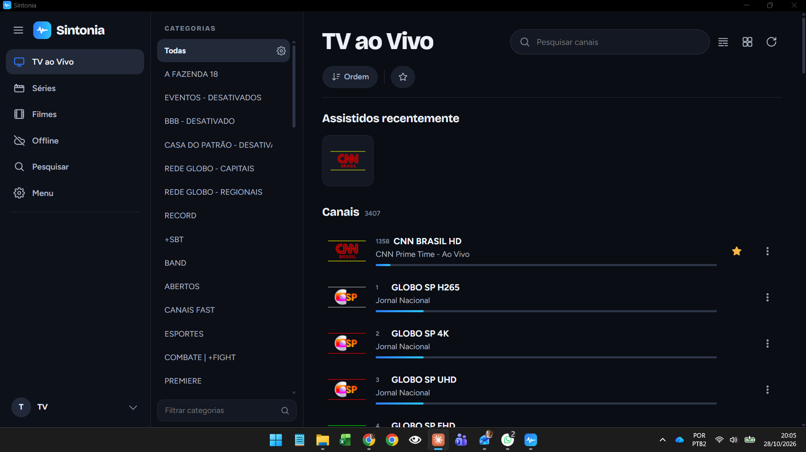
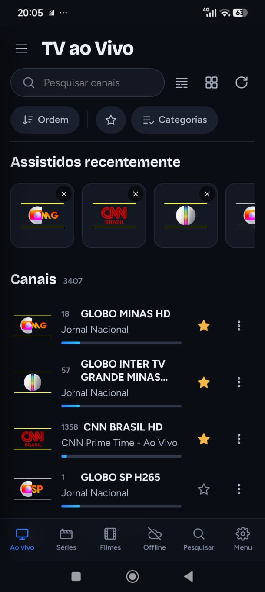
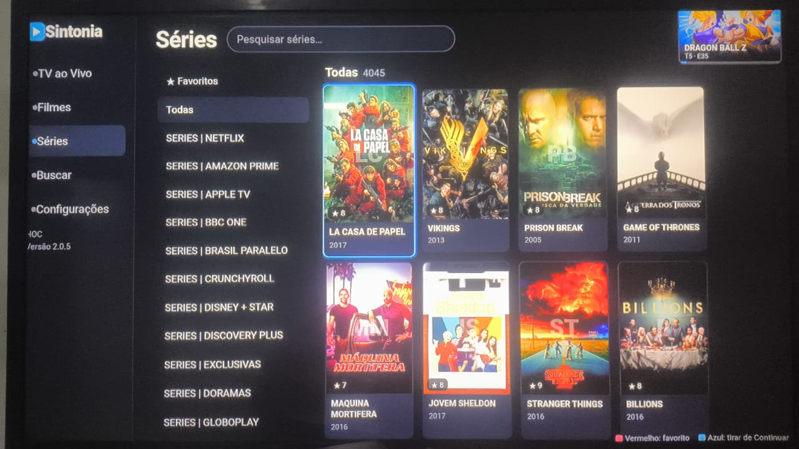

<div align="center">

# 📡 Sintonia

**Player IPTV moderno para Android, Android TV, TV LG (webOS), Windows e Linux.**

TV ao vivo com guia de programação, filmes, séries, downloads e gravações — tudo em uma interface escura, rápida e feita para celular, PC e controle remoto.

<br>

<a href="https://github.com/heitorcampos2/Sintonia/raw/main/downloads/Sintonia-2.3.3.apk">
  
</a>

<br><br>

<a href="https://github.com/heitorcampos2/Sintonia/raw/main/downloads/Sintonia-Windows-2.3.3.zip"></a>
<a href="https://github.com/heitorcampos2/Sintonia/raw/main/downloads/sintonia_2.3.3_all.deb"></a>
<a href="https://github.com/heitorcampos2/Sintonia/raw/main/downloads/Sintonia-TV-LG-2.3.3.ipk"></a>


</div>

---

## 📸 Telas

<table>
  <tr>
    <td colspan="2" align="center"><br><sub><b>Windows</b> — TV ao Vivo com categorias, recentes e programação atual</sub></td>
  </tr>
  <tr>
    <td width="32%" align="center"><br><sub><b>Android</b> — celular</sub></td>
    <td align="center"><br><sub><b>TV LG (webOS)</b> — Séries com navegação por controle remoto</sub></td>
  </tr>
</table>

## ✨ Funcionalidades

### 📺 TV ao Vivo
- Lista de canais com **logo, número e programa no ar** com barra de progresso
- **Guia de programação (EPG / XMLTV)**: agora, grade completa e programação por canal
- **Catch-up** (assistir programas que já passaram, quando o provedor suporta)
- **Assistidos recentemente**, **favoritos** ⭐ e ordenação personalizada
- Visualização em **lista ou grade**, busca de canais e filtro de categorias
- **Gravação** de canais ao vivo

### 🎬 Filmes e Séries
- Catálogo com capas, nota, ano e detalhes
- Categorias do provedor, favoritos e **Continuar assistindo**
- Temporadas e episódios com retomada de onde parou

### ⬇️ Offline
- **Download** de filmes e episódios para assistir sem internet
- Fila com até 2 downloads em paralelo, pausar, retomar e repetir

### 🔌 Fontes compatíveis
- **Xtream Codes** (usuário e senha)
- **Lista M3U / M3U8**
- **Portal Stalker / MAC**
- Várias fontes cadastradas, com troca rápida e atualização do catálogo

### 🆕 Novo na 2.3.3
- **Celular/tablet:** tirado o retângulo preto que aparecia no meio do player (a caixinha de brilho/volume só aparece durante o gesto)

### Novo na 2.3.2
- **Ao vivo abre mais rápido** — quando o DNS da internet não acha o servidor da lista (levava ~3 s para desistir a cada canal), o Sintonia pergunta ao DNS da rede e ao DNS seguro ao mesmo tempo e usa o primeiro que responder
- **Android TV:** endereço do servidor resolvido ao abrir o app; ao vivo começa com 0,5 s de vídeo
- **Celular, tablet e PC:** o ao vivo chega ao player mais cedo

### Novo na 2.3.1
- **TV:** escolha quando atualizar a lista (toda vez que abrir, a cada 6/12 h, 1×/dia, a cada 3 dias, 1×/semana ou só manual)
- **TV:** segure OK num item para ver as opções (canais, filmes, séries, Continuar assistindo e listas)
- **TV:** Configurações em grupos e nova tela **Personalização**, igual à do celular (aba e categoria inicial, ordem padrão, favoritos primeiro, canais recentes, formato de hora, cor, limpar histórico)

### Novo na 2.3.0
- **Abre bem mais rápido** — canais, filmes e séries aparecem na hora com a última lista guardada; a lista nova é conferida em segundo plano (celular, tablet, PC, Android TV e TV LG)
- **TV:** botão *Ordem* (A → Z, adicionados, lançamento, nota) e modo de tela no player (ajustar, preencher, zoom, largura, altura — botão *Tela* ou botão verde)
- **Celular/tablet:** gestos no player — deslize à esquerda para o brilho e à direita para o volume
- **Sincronizar aparelhos** acha os outros Sintonia da rede na hora por mDNS

### Novo na 2.2.6
- **Android TV:** o player não vira mais imagem no canto (miniatura) — saiu do vídeo, ele fecha e guarda onde parou; nunca ficam dois canais abertos
- **Android TV e TV LG com o visual do celular/tablet:** menu com ícones, coluna de categorias, busca no canto, canais em lista de duas colunas, filmes e séries em grade
- **Controle remoto mais fácil:** passar pela categoria já mostra os itens, → entra na lista, ← volta para a categoria e para o menu (que lembra onde você estava), CH+/CH− pulam uma página

### Novo na 2.2.5
- **Listas que funcionam em outros apps de IPTV agora carregam em todos os aparelhos** — quando o DNS da internet/roteador não acha o endereço do servidor (ficava em *"Carregando canais…"* ou *"Sem conexão com o servidor da lista"*), o Sintonia usa o DNS seguro da Cloudflare e do Google, como os apps de IPTV. Vale também para o player
- Quando o servidor da lista demora e a Cloudflare responde erro 520-524, o Sintonia tenta de novo sozinho

### Novo na 2.2.4
- **Android TV:** listas que funcionam em outros apps de IPTV e davam *"Sem conexão com o servidor da lista"* agora carregam — a TV busca a lista pelo Android, como os apps de IPTV (se identifica como VLC e aceita servidor com certificado https com problema)
- Mensagens de erro mais claras na TV (endereço não encontrado, porta recusada, servidor demorando)

### Novo na 2.2.3
- **Android TV:** voltou a tela própria de TV (a de antes da 2.2.0), leve e feita para o controle remoto — corrige filmes que fechavam sozinhos depois de um tempo. Continua com o player nativo rápido da 2.2.2.
- **Atualização:** sugestão do **SmartTube (estável)**, com botão para baixar a última versão.

### Novo na 2.2.2
- **Android TV: ao vivo bem mais rápido** — os canais tocam no player nativo do Android (ExoPlayer), direto do provedor; trocar de canal com ▲▼ só carrega onde você parar. Filmes e séries continuam no player do celular
- Navegação pelo controle mais leve em listas grandes; *Menu › Reprodutor › Player da TV* para escolher (o do celular continua disponível para gravar)

### Novo na 2.2.1
- **Canais e vídeos começam bem mais rápido**: o ao vivo abre em cerca de 1 s (antes esperava montar 5 s de reserva e mais 2 MB de vídeo antes de mostrar a imagem)
- Componentes de vídeo já carregados ao abrir o app; interface abre mais rápido (arquivos guardados, sem reenvio)
- **Mais leve** na TV e em aparelhos com pouca memória: menos vídeo guardado na memória e sem efeitos de desfoque

### Novo na 2.2.0
- **Android TV igual ao celular e ao tablet**: mesma interface e mesmas funções (downloads, gravações, multitela, guia, sincronizar, importar/exportar, personalização), tudo pelo **controle remoto** (direcional, OK, Voltar e tecla Menu). No player, OK mostra os controles e as setas avançam ou trocam de canal
- Na TV, opcional: **player nativo do Android** (Menu › Reprodutor), mais leve em TV box fraca
- **Pasta dos downloads e das gravações**: escolha navegando pelas pastas do aparelho (memória, cartão, pendrive ou disco) em *Offline › Trocar pasta* ou *Menu › Personalização*, no Windows, Linux, Android e Android TV

### Novo na 2.1.2
- **Android:** corrigido o erro "pacote inválido" ao instalar ou atualizar (o APK da 2.1.1 saiu marcado como teste)

### Novo na 2.1.1
- Sobre › Atualização: sugestão do **[Spectra Launcher](https://github.com/heitorcampos2/Spectra-launcher)** (tela inicial para Android TV), com botão para baixar
- Sobre: desenvolvedor **Heitor Campos** ([GitHub heitorcampos2](https://github.com/heitorcampos2))

### Novo na 2.1.0
- **Gravar**: um toque começa a gravar, o botão vira **Parar** e aparece a **bolinha vermelha "Gravando"** com o tempo
- Em tela cheia, as opções aparecem **por cima do vídeo**

### Novo na 2.0.9
- **Downloads completos**: se a internet cair ou o provedor cortar a conexão, o download espera e **continua de onde parou, sem perder a %**. Fechou o Sintonia no meio? Ao abrir, ele continua sozinho

### Novo na 2.0.8
- **Celular em pé**: as temporadas da série aparecem numa **lista suspensa**

### Novo na 2.0.7
- **Sincronização fácil na rede** *(opcional, perguntada na primeira abertura)*: o Sintonia **encontra sozinho** os outros aparelhos com Sintonia no mesmo Wi-Fi e junta listas, favoritos e "continuar assistindo" — sem digitar IP
- **Parear por QR**: *Menu › Sincronizar aparelhos na rede › Mostrar QR deste aparelho* e leia com o celular
- **Importar e exportar listas** por arquivo, texto, link ou **QR code** (o celular Android lê com a câmera; a TV mostra a lista em QR)
- **Anterior / próximo no player**: troca de canal, episódio ou filme da mesma categoria
- **Título personalizado com logomarca (PNG)** no espaço livre da barra lateral (*Menu › Tema e cores*)
- **TV (Android TV e LG)**: busca o Sintonia do PC na rede e sincroniza nos dois sentidos
- **Atualização pelo GitHub**: quando sai versão nova aparece **🔁 no canto superior direito**. No PC (Windows/Linux) atualiza e reabre sozinho; no Android baixa o APK e abre o instalador; na TV LG mostra qual arquivo instalar

### 🛠️ Mais
- **Imagem no canto (PiP)** no Android
- **Controle parental** com PIN
- **Sincronização opcional** de fontes, favoritos, histórico e configurações entre aparelhos (PC, tablet, celular e TV)
- No PC, pode ser **aberto pela rede** em outros aparelhos ou instalado como **app do Chrome (PWA)**
- **Diagnóstico** de conexão com a fonte
- Interface própria para **TV/TV box** com controle remoto (atalhos nos botões coloridos)
- Temas, cor de destaque e aba inicial configuráveis

## 📥 Download

| Plataforma | Arquivo | Requisitos |
|---|---|---|
| 🤖 **Android** (celular, tablet, TV box, Android TV) | [Sintonia-2.3.3.apk](https://github.com/heitorcampos2/Sintonia/raw/main/downloads/Sintonia-2.3.3.apk) | Android 7 ou mais novo |
| 🪟 **Windows** | [Sintonia-Windows-2.3.3.zip](https://github.com/heitorcampos2/Sintonia/raw/main/downloads/Sintonia-Windows-2.3.3.zip) | Windows 10/11 (o instalador instala o Python se faltar) |
| 🐧 **Linux** (Ubuntu / Debian / udroid) | [sintonia_2.3.3_all.deb](https://github.com/heitorcampos2/Sintonia/raw/main/downloads/sintonia_2.3.3_all.deb) | Python 3 |
| 📺 **TV LG** (webOS) | [Sintonia-TV-LG-2.3.3.ipk](https://github.com/heitorcampos2/Sintonia/raw/main/downloads/Sintonia-TV-LG-2.3.3.ipk) | Modo desenvolvedor ativado |

Os arquivos ficam na pasta **[`downloads/`](downloads)**.

## 🚀 Como instalar

<details>
<summary><b>🤖 Android</b></summary>

1. Baixe o **Sintonia-2.3.3.apk** no aparelho (ou copie por pendrive).
2. Abra pelo gerenciador de arquivos.
3. Se pedir, permita **"instalar apps de fontes desconhecidas"**.

Na TV/TV box o app aparece na tela inicial e usa uma tela própria para controle remoto.
**PiP:** no player toque no botão de janelinha (barra de cima) ou aperte *Início* com o vídeo tocando.
</details>

<details>
<summary><b>🪟 Windows</b></summary>

1. Extraia o `.zip` (botão direito › *Extrair tudo*).
2. Dê dois cliques em **`Instalar Sintonia.bat`**.
   - Se aparecer "O Windows protegeu o computador": *Mais informações* › *Executar assim mesmo*.
3. O Sintonia abre em janela própria, com atalho na Área de Trabalho e no Menu Iniciar.

**Atualizar:** Menu Iniciar › Sintonia › *Parar o Sintonia*, instale por cima e abra de novo.
</details>

<details>
<summary><b>🐧 Linux (.deb)</b></summary>

```bash
sintonia --parar 2>/dev/null; pkill -f "sintonia" 2>/dev/null; sleep 1
sudo apt install -y ./sintonia_2.3.3_all.deb
sintonia --abrir
```
</details>

<details>
<summary><b>📺 TV LG (webOS)</b></summary>

1. Na TV: **LG Content Store** › app **Developer Mode** › ative *Dev Mode Status* e *Key Server*. Anote o IP e a Passphrase.
2. Com o celular Android (Termux, instalado pelo F-Droid) na mesma rede Wi-Fi:

```bash
termux-setup-storage
pkg update -y && pkg install -y nodejs
npm install -g @webos-tools/cli
ares-setup-device -a tv -i "host=IP_DA_TV" -i "port=9922" -i "username=prisoner"
ares-novacom --device tv --getkey
ares-install --device tv ~/storage/downloads/Sintonia-TV-LG-2.3.3.ipk
```

O modo desenvolvedor expira a cada 50 horas — renove com `ares-extend-dev --device tv`.
</details>

Guia completo: [`docs/COMO-INSTALAR.txt`](docs/COMO-INSTALAR.txt)

## ⚠️ Aviso

O Sintonia é **apenas um player**. Ele **não fornece, hospeda nem vende** canais, filmes, séries ou listas IPTV. Você precisa ter sua própria lista ou assinatura de um provedor e é responsável pelo conteúdo que acessa. Logos e capas exibidos nas telas pertencem aos seus respectivos donos.

---

<div align="center">
Desenvolvido por <b>Heitor Campos</b> · <a href="https://github.com/heitorcampos2">github.com/heitorcampos2</a>
</div>
