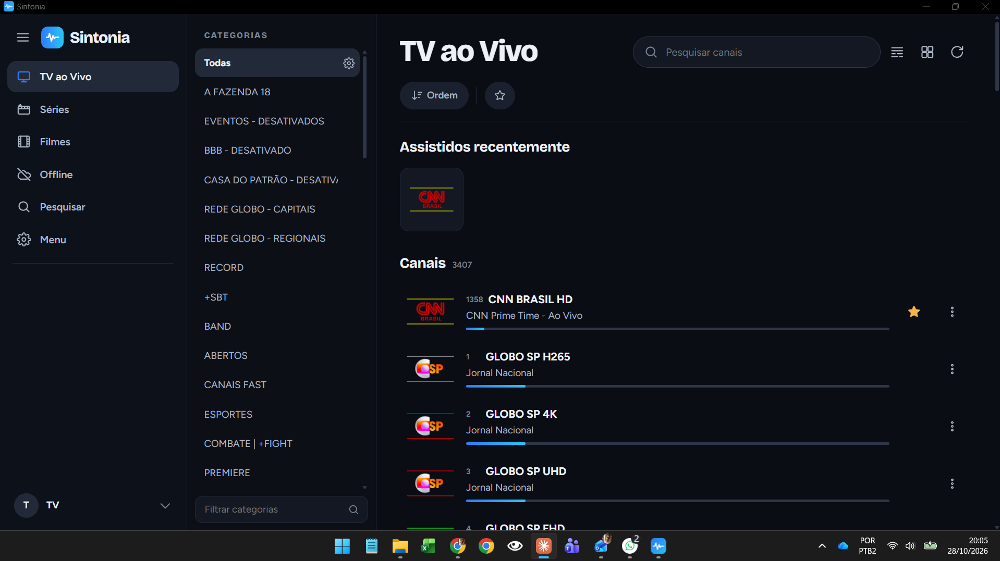
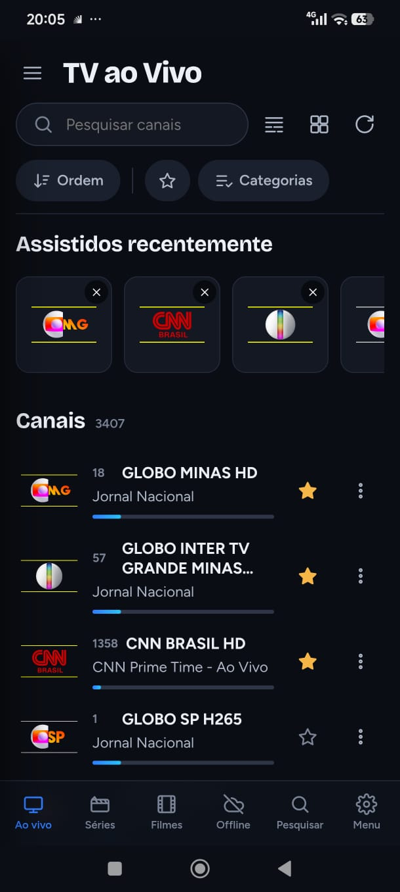
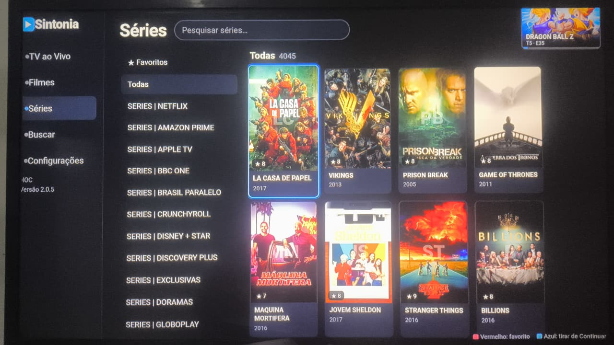

<div align="center">

# 📡 Sintonia

**Player IPTV moderno para Android, Android TV, TV LG (webOS), Windows e Linux.**

TV ao vivo com guia de programação, filmes, séries, downloads e gravações — tudo em uma interface escura, rápida e feita para celular, PC e controle remoto.

<br>

<a href="https://github.com/heitorcampos2/Sintonia/raw/main/downloads/Sintonia-2.0.6.apk">
  
</a>

<br><br>

<a href="https://github.com/heitorcampos2/Sintonia/raw/main/downloads/Sintonia-Windows-2.0.7.zip"></a>
<a href="https://github.com/heitorcampos2/Sintonia/raw/main/downloads/sintonia_2.0.7_all.deb"></a>
<a href="https://github.com/heitorcampos2/Sintonia/raw/main/downloads/Sintonia-TV-LG-2.0.7.ipk"></a>


</div>

---

## 📸 Telas

<table>
  <tr>
    <td colspan="2" align="center"><br><sub><b>Windows</b> — TV ao Vivo com categorias, recentes e programação atual</sub></td>
  </tr>
  <tr>
    <td width="32%" align="center"><br><sub><b>Android</b> — celular</sub></td>
    <td align="center"><br><sub><b>TV LG (webOS)</b> — Séries com navegação por controle remoto</sub></td>
  </tr>
</table>

## ✨ Funcionalidades

### 📺 TV ao Vivo
- Lista de canais com **logo, número e programa no ar** com barra de progresso
- **Guia de programação (EPG / XMLTV)**: agora, grade completa e programação por canal
- **Catch-up** (assistir programas que já passaram, quando o provedor suporta)
- **Assistidos recentemente**, **favoritos** ⭐ e ordenação personalizada
- Visualização em **lista ou grade**, busca de canais e filtro de categorias
- **Gravação** de canais ao vivo

### 🎬 Filmes e Séries
- Catálogo com capas, nota, ano e detalhes
- Categorias do provedor, favoritos e **Continuar assistindo**
- Temporadas e episódios com retomada de onde parou

### ⬇️ Offline
- **Download** de filmes e episódios para assistir sem internet
- Fila com até 2 downloads em paralelo, pausar, retomar e repetir

### 🔌 Fontes compatíveis
- **Xtream Codes** (usuário e senha)
- **Lista M3U / M3U8**
- **Portal Stalker / MAC**
- Várias fontes cadastradas, com troca rápida e atualização do catálogo

### 🆕 Novo na 2.0.7
- **Sincronização fácil na rede** *(opcional, perguntada na primeira abertura)*: o Sintonia **encontra sozinho** os outros aparelhos com Sintonia no mesmo Wi-Fi e junta listas, favoritos e "continuar assistindo" — sem digitar IP
- **Parear por QR**: *Menu › Sincronizar aparelhos na rede › Mostrar QR deste aparelho* e leia com o celular
- **Importar e exportar listas** por arquivo, texto, link ou **QR code** (o celular Android lê com a câmera; a TV mostra a lista em QR)
- **Anterior / próximo no player**: troca de canal, episódio ou filme da mesma categoria
- **Título personalizado com logomarca (PNG)** no espaço livre da barra lateral (*Menu › Tema e cores*)
- **TV (Android TV e LG)**: busca o Sintonia do PC na rede e sincroniza nos dois sentidos
- **Atualização pelo GitHub**: quando sai versão nova aparece **🔁 no canto superior direito**. No PC (Windows/Linux) atualiza e reabre sozinho; no Android baixa o APK e abre o instalador; na TV LG mostra qual arquivo instalar

### 🛠️ Mais
- **Imagem no canto (PiP)** no Android
- **Controle parental** com PIN
- **Sincronização opcional** de fontes, favoritos, histórico e configurações entre aparelhos (PC, tablet, celular e TV)
- No PC, pode ser **aberto pela rede** em outros aparelhos ou instalado como **app do Chrome (PWA)**
- **Diagnóstico** de conexão com a fonte
- Interface própria para **TV/TV box** com controle remoto (atalhos nos botões coloridos)
- Temas, cor de destaque e aba inicial configuráveis

## 📥 Download

| Plataforma | Arquivo | Requisitos |
|---|---|---|
| 🤖 **Android** (celular, tablet, TV box, Android TV) | [Sintonia-2.0.6.apk](https://github.com/heitorcampos2/Sintonia/raw/main/downloads/Sintonia-2.0.6.apk) | Android 7 ou mais novo · *o APK 2.0.7 sai em breve* |
| 🪟 **Windows** | [Sintonia-Windows-2.0.7.zip](https://github.com/heitorcampos2/Sintonia/raw/main/downloads/Sintonia-Windows-2.0.7.zip) | Windows 10/11 (o instalador instala o Python se faltar) |
| 🐧 **Linux** (Ubuntu / Debian / udroid) | [sintonia_2.0.7_all.deb](https://github.com/heitorcampos2/Sintonia/raw/main/downloads/sintonia_2.0.7_all.deb) | Python 3 |
| 📺 **TV LG** (webOS) | [Sintonia-TV-LG-2.0.7.ipk](https://github.com/heitorcampos2/Sintonia/raw/main/downloads/Sintonia-TV-LG-2.0.7.ipk) | Modo desenvolvedor ativado |

Os arquivos ficam na pasta **[`downloads/`](downloads)**.

## 🚀 Como instalar

<details>
<summary><b>🤖 Android</b></summary>

1. Baixe o **Sintonia-2.0.6.apk** *(a 2.0.7 do Android sai em breve)* no aparelho (ou copie por pendrive).
2. Abra pelo gerenciador de arquivos.
3. Se pedir, permita **"instalar apps de fontes desconhecidas"**.

Na TV/TV box o app aparece na tela inicial e usa uma tela própria para controle remoto.
**PiP:** no player toque no botão de janelinha (barra de cima) ou aperte *Início* com o vídeo tocando.
</details>

<details>
<summary><b>🪟 Windows</b></summary>

1. Extraia o `.zip` (botão direito › *Extrair tudo*).
2. Dê dois cliques em **`Instalar Sintonia.bat`**.
   - Se aparecer "O Windows protegeu o computador": *Mais informações* › *Executar assim mesmo*.
3. O Sintonia abre em janela própria, com atalho na Área de Trabalho e no Menu Iniciar.

**Atualizar:** Menu Iniciar › Sintonia › *Parar o Sintonia*, instale por cima e abra de novo.
</details>

<details>
<summary><b>🐧 Linux (.deb)</b></summary>

```bash
sintonia --parar 2>/dev/null; pkill -f "sintonia" 2>/dev/null; sleep 1
sudo apt install -y ./sintonia_2.0.7_all.deb
sintonia --abrir
```
</details>

<details>
<summary><b>📺 TV LG (webOS)</b></summary>

1. Na TV: **LG Content Store** › app **Developer Mode** › ative *Dev Mode Status* e *Key Server*. Anote o IP e a Passphrase.
2. Com o celular Android (Termux, instalado pelo F-Droid) na mesma rede Wi-Fi:

```bash
termux-setup-storage
pkg update -y && pkg install -y nodejs
npm install -g @webos-tools/cli
ares-setup-device -a tv -i "host=IP_DA_TV" -i "port=9922" -i "username=prisoner"
ares-novacom --device tv --getkey
ares-install --device tv ~/storage/downloads/Sintonia-TV-LG-2.0.7.ipk
```

O modo desenvolvedor expira a cada 50 horas — renove com `ares-extend-dev --device tv`.
</details>

Guia completo: [`docs/COMO-INSTALAR.txt`](docs/COMO-INSTALAR.txt)

## ⚠️ Aviso

O Sintonia é **apenas um player**. Ele **não fornece, hospeda nem vende** canais, filmes, séries ou listas IPTV. Você precisa ter sua própria lista ou assinatura de um provedor e é responsável pelo conteúdo que acessa. Logos e capas exibidos nas telas pertencem aos seus respectivos donos.

---

<div align="center">
Feito por <b>Heitor Campos</b>
</div>
